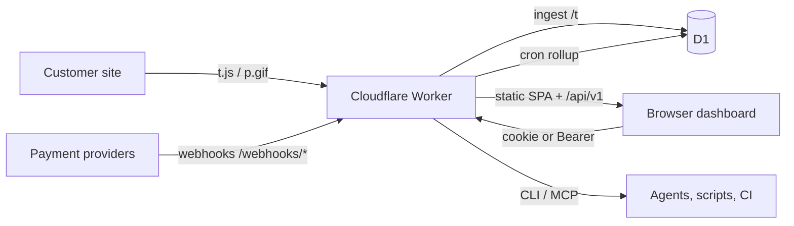
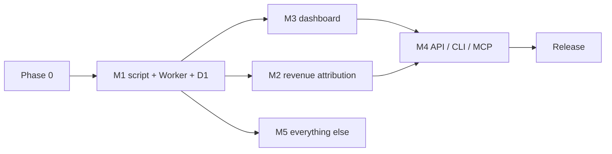

# DataGoat Roadmap

Status: Milestone 1 deployed; Milestone 2 merged and awaiting deploy configuration.

| Deliverable | State |
| --- | --- |
| Phase 0 — `packages/worker` layout, `wrangler.example.toml`, `0001_init.sql` (15 tables, `api_tokens` per D6), CI workflow | merged (`867ccac`); CI workflow file still missing (needs the GitHub `workflow` scope) |
| Milestone 1 — ingestion Worker (`POST /t`, `GET /p.gif`, `GET /t.js`, validation, idempotency, KV rate limits, bot filter, enrichment, cron rollup) | merged (`867ccac`), **deployed** to `datagoat-ingest`; 49/49 tests pass |
| Milestone 1 — tracking script + npm surface (`dist/t.js`, checkout helpers) | merged (`25f22f4`); 25/25 tests pass, 5041 B gzip |
| Milestone 1 — friendly `GET /` root response | merged (`b87997b`), deployed; 49/49 tests pass |
| Milestone 2 — revenue attribution (webhooks, joins, credit rules, refunds, re-attribution, §8 queries), migration `0002` | merged (`48a3584`); 78/78 tests pass. Not deployed — needs per-site payment webhook secrets |

Live deployment: `datagoat-ingest` at https://datagoat-ingest.mrnobody.workers.dev
(D1 `datagoat-ingest`, KV `datagoat-rate-limit`). Milestone 2 needs a site's
webhook secret stored in `payment_integrations` (or `WEBHOOK_SECRET_<PROVIDER>`)
before its `/webhooks/*` routes return anything other than
`webhook_not_configured`.

See the per-phase sections below for acceptance criteria and open decisions.

This document consolidates the five design proposals in [`design/`](design/)
into one sequenced plan. It is the source of truth for what we build, in what
order, and what still needs a decision.

## Milestone sequence

The order below is fixed by the user (sarequl). Do not reorder it. Do not run a
later milestone's work in parallel with an earlier one.

| # | Milestone | Feeds from |
| --- | --- | --- |
| 1 | Tracking script + ingestion Worker + D1 schema | `worker.md`, `script.md`, `attribution.md` §1–§2 |
| 2 | Revenue attribution (payment webhooks, first/last-touch, LTV) | `attribution.md`, `worker.md` §5.3–5.4, `api.md` §2.2 |
| 3 | Dashboard (traffic + revenue by source, funnels, live visitors) | `dashboard.md`, `api.md` §2.1, `attribution.md` §8 |
| 4 | API / CLI / MCP | `api.md`, `worker.md` §10, `dashboard.md` §13.5 |
| 5 | Everything else (mobile app, team accounts, social mentions) | `api.md` §2.3/§6, `dashboard.md` §7 |

Phase 0 below is the foundation that precedes milestone 1; it is not a product
milestone. The mobile app in milestone 5 has **no design doc yet** and must not
start until one exists and the crew is free of milestones 1–3.

## Sources

| Document | Owner | Scope |
| --- | --- | --- |
| [`design/worker.md`](design/worker.md) | Worker Engineer | Ingestion Worker, D1 schema, cron rollup, bot filter, read routes, resolved contract items (§12.1) |
| [`design/api.md`](design/api.md) | API & Integrations Engineer | `/api/v1` surface, tokens, envelopes, CLI, MCP, GSC, mentions |
| [`design/dashboard.md`](design/dashboard.md) | Dashboard Engineer | Static SPA, charts, session auth, component list, milestones |
| [`design/script.md`](design/script.md) | Script & SDK Engineer | Tracking script, beacon payload, visitor id, cross-domain, npm surface |
| [`design/attribution.md`](design/attribution.md) | Attribution Engineer | Credit rules, payment schema, provider webhooks, joins, refunds, derived metrics |

`worker.md` §12.1 records the contract items already resolved with the Script &
SDK Engineer on 2026-11-02. Those are folded in below as settled decisions, not
open questions.

## Target architecture

One Worker, one D1 database, one deploy command. The Worker serves the tracking
endpoints, the read API, and the static dashboard. No separate Node server, no
SSR, no third-party origins at runtime.

## Consolidated decisions

Settled by the design docs; do not re-open without a reason.

| Area | Decision | Source |
| --- | --- | --- |
| Ingestion transport | `POST /t` (JSON beacon, no CORS preflight, `204`); `GET /p.gif` pixel; `GET /t.js` static | `script.md` §3, `worker.md` §12.1 |
| Browser write path | One beacon per pageview; `sendBeacon` survives unload | `script.md` §1 |
| Storage model | `events` is append-only and the only hot table; `sessions`/`visitors`/`daily_aggregates` are derived by a cron rollup | `worker.md` §2, §9 |
| Idempotency | Per-event `event_id` is the dedup key (not the per-pageview `pvid`) | `worker.md` §12.1 |
| Sessionization | 30-minute inactivity window, server-authoritative; midnight split configurable (default off) | `worker.md` §9, §12.1 |
| Cookie prefix | `_dg_` (`_dg_vid`, `_dg_ses`) | `worker.md` §12.1 |
| Privacy modes | `cookies`, `localstorage`, `cookieless`, `consent` | `worker.md` §11, `script.md` §5 |
| Visitor id | Cookie `_dg_vid` in cookie mode; HMAC-SHA256(`install_secret`, site+ip+ua+day) in cookieless mode | `script.md` §5, `worker.md` §11 |
| Bot filtering | Three levels (`off`/`standard`/`strict`); client `bs` is a pre-filter, the Worker is authoritative and stores `bot_score` | `worker.md` §7, §12.1 |
| Geo | `request.cf.country` only; no external GeoIP lookup | `worker.md` §12.1 |
| Attribution models | `last_non_direct` (default), `first_touch`, `last_touch`; **all three credit sets stored on each payment** | `attribution.md` §3 |
| Attribution window | 30 days for last-touch / last-non-direct; first-touch is lifetime | `attribution.md` §3–4 |
| Revenue ingestion | Server-side only; provider webhooks plus a payments API | `attribution.md` §7, `worker.md` §5.3–5.4 |
| API base and envelopes | `/api/v1/`; `{"data": …}` and `{"error": {code, message}}` | `api.md` §0 |
| Dashboard stack | React 18 + TypeScript, Vite, TanStack Query, Chart.js v4 | `dashboard.md` §2 |
| Dashboard auth | httpOnly session cookie (HS256 JWT), not a JS-held Bearer token | `dashboard.md` §5 |
| Realtime | Polling, not streaming, in v0 | `dashboard.md` §9, `worker.md` §13 |
| Checkout handoff | `getCheckoutContext()` / `setCheckoutMetadata()` so payments carry `visitor_id` | `attribution.md` §6.2 |

## Open decisions

Each needs an owner and a default proposal to fall back on. Items marked
**blocking** gate the milestone they are listed in.

| ID | Question | Default proposal | Owner | Blocking |
| --- | --- | --- | --- | --- |
| D1 | Repo layout and migrations | `packages/worker` with `migrations/`, applied by `wrangler d1 migrations apply` | OSS Maintainer | Phase 0 |
| D2 | Auth ownership (users + session/JWT) | Worker owns `users`; dashboard session cookie per `dashboard.md` §5 | Worker + Dashboard Engineer | M3 |
| D3 | Rate-limit store | KV fixed-window counters, not a D1 write on the hot path | Worker Engineer | M1 |
| D4 | Datacenter list for `strict` bot filtering | Versioned `src/data/datacenter_asns.txt`, like `bots.txt` | Worker Engineer | M1 |
| D5 | Cookieless secret rotation | Manual secret swap; document that it resets cookieless ids | Worker Engineer | M1 |
| D6 | Token table name | One table, `api_tokens` (`kind` = read/ingest/account); rename `worker.md`'s `api_keys` to match | Worker Engineer | Phase 0 |
| D7 | Three-token model vs one key | Keep the three types (`dg_read_`, `dg_ingest_`, `dgt_`) | API Engineer | M4 |
| D8 | Mentions (X/Reddit) | Ship `mentions` as an empty, documented table with the collector stubbed until access is decided | API Engineer | M5 |
| D9 | `gsc_daily` retention | Keep 24 months, then aggregate into `daily_aggregates` | API Engineer | M5 |
| D10 | `dgt_` tokens for single-tenant | Ship them for CLI/MCP/CI; the dashboard uses the session cookie | API Engineer | M4 |
| D11 | MCP write safety | `confirm`/dry-run for irreversible tools, plus `idempotencyKey` | API Engineer | M4 |
| D12 | Session endpoints | Add `POST /api/v1/session` and `/session/logout`; middleware accepts cookie-or-Bearer | Dashboard + API Engineer | M3 |
| D13 | Period deltas | Client-side delta from a second `overview` fetch until the endpoint gains a `previous` block | Dashboard Engineer | M3 |
| D14 | Dispute handling | Add a `disputed_minor` column; derive the rest from status | Worker Engineer | M2 |
| D15 | First-touch reset | Lifetime first-touch in v0; make the window configurable later | Attribution Engineer | M2 |
| D16 | Identity merging | Keep visitor metrics separate; merge for customer/LTV-by-email | Attribution Engineer | M2 |
| D17 | Reporting currency | Native-currency revenue; USD only for cross-currency rollup | CMO + Attribution Engineer | M2 |
| D18 | Multi-currency FX source | Pick one open rate source; null `amount_usd_minor` on a missing rate and show a "missing FX" counter | Attribution Engineer | M2 |
| D19 | Alert delivery | Worker writes `alert_rules` + an outbox row only; sending is out of scope | Worker Engineer | M5 |
| D20 | Creem `metadata` key | Verify the accepted key name against the Creem API reference | Attribution Engineer | M2 |
| D21 | Polar dual-key HMAC | Vendor a Standard Webhooks library rather than implement both key encodings | Worker Engineer | M2 |
| D22 | Realtime transport | 10 s polling in v0; design the component so SSE can be swapped in later | Dashboard Engineer | M3 |

## Phase 0 — Foundation

Precedes milestone 1. Not a product milestone.

- Land the repository layout (D1), the D1 migration toolchain, and the
  environment/secret contract.
- Freeze the token table name (D6) so Worker, Script, and API work against one
  contract. Endpoint paths are already resolved (`worker.md` §12.1).
- Add CI: lint, type-check, unit tests, and a deploy preview.

Acceptance: a clean clone installs, lints, type-checks, and runs tests; a
`wrangler.toml` template creates a local D1 and applies `0001_init.sql`.

## Milestone 1 — Tracking script + ingestion Worker + D1 schema

**Feeds from:** `worker.md`, `script.md`, `attribution.md` §1–§2.

- Implement `POST /t` and `GET /p.gif` with validation, idempotency, and rate
  limits (D3).
- Implement the D1 schema from `worker.md` §3, extended with the columns agreed
  in §12.1 (`bot_score`, `group_id`, `colo`, `viewport_w/h`, `dpr`, `tz`,
  `is_new_visitor`, `is_new_session`, `site_token`).
- Implement server-side enrichment: geo, UA parse, bot decision, channel
  classification, UTM parsing, session id, and the dedup key.
- Implement the cron rollup into `sessions`, `visitors`, and `daily_aggregates`
  (`worker.md` §9) plus retention.
- Add the datacenter list for `strict` filtering (D4) and the cookieless
  rotation procedure (D5).
- Ship `GET /t.js` and the tracker per `script.md`: async load, pageview + SPA
  route changes, scroll depth, `window.datagoat()` queue,
  `trackEvent`/`identify`/`reset`/`optOut`, cookie/cookieless/localstorage modes
  and the fallback chain, subdomain cookies, and cross-domain link decoration.
- Ship the checkout helpers `getCheckoutContext()` / `setCheckoutMetadata()`
  (`attribution.md` §6.2) so milestone 2 has a working handoff.

Acceptance: a pageview beacon produces exactly one `events` row, is deduped on
replay, is rejected for a non-allowed host, and appears in `daily_aggregates`
after one rollup tick. Bot events are dropped at `standard`/`strict`. The script
is under 5 KB gzipped and loads async.

## Milestone 2 — Revenue attribution (payment webhooks, first/last-touch, LTV)

**Feeds from:** `attribution.md`, `worker.md` §5.3–5.4, `api.md` §2.2.

- Implement the shared webhook pipeline and the Stripe, Polar, Dodo, and Creem
  adapters (`attribution.md` §7), including signature verification and the
  `webhook_events` idempotency ledger.
- Implement the payment→visitor join paths and the four-way `join_method`
  priority (`attribution.md` §6).
- Implement all three credit sets, the 30-day window, and refunds/disputes
  (`attribution.md` §3–§5, §9).
- Implement re-attribution and back-fill within `REATTRIBUTION_DAYS` (default 90).
- Implement revenue-by-source, LTV, revenue-per-visitor, path-to-purchase, and
  cohort queries (`attribution.md` §8).
- Resolve D14–D18, D20, D21 (dispute column, first-touch reset, identity merge,
  reporting currency, FX source, Creem metadata key, Polar dual-key).

Acceptance: a webhook upserts one `payments` row idempotently, credits the
channel per the site's attribution model, and refunds reduce net revenue
everywhere without rewriting history.

## Milestone 3 — Dashboard (traffic + revenue by source, funnels, live visitors)

**Feeds from:** `dashboard.md`, `api.md` §2.1, `attribution.md` §8.

The API is not implemented until milestone 4, so the dashboard is built against
the **frozen** `/api/v1` contract with a mocked server (as `dashboard.md` §2
already plans). This is deliberate: the contract is frozen in `api.md`, so the
dashboard and API can be built in this order without drift.

Follow the `dashboard.md` milestones M0–M5, in order:

- **M0** — shell, router, session auth (D2, D12), theme tokens, CI build.
- **M1** — KPI grid + timeseries, period selector wired to the URL, client-side
  deltas (D13).
- **M2** — source tabs, chart + table, website switcher, filters.
- **M3** — funnels and goals, including funnels that end at a payment.
- **M4** — live visitors (polling, D22).
- **M5** — settings (API keys, team, metadata), accessibility audit, perf budget
  (< 150 KB gz initial bundle), docs.

Acceptance: the dashboard is served by the Worker, logs in with the cookie,
renders every dashboard need in `dashboard.md` §4, and meets the perf budget.
Playwright e2e runs against a mocked `/api/v1`.

## Milestone 4 — API / CLI / MCP

**Feeds from:** `api.md`, `worker.md` §10, `dashboard.md` §13.5.

- Implement the `/api/v1` analytics and breakdown routes from `api.md` §2.1
  against `daily_aggregates` and `sessions`/`visitors`, so the dashboard's mocks
  are replaced by the real server.
- Implement the envelopes, error codes, pagination, and query-param validation.
- Implement token resolution and permission checks (D7, D10).
- Build the `datagoat` CLI over the read API and the admin endpoints (`api.md` §3).
- Build the `datagoat-mcp` server with the tool catalog and the `confirm`/dry-run
  safety pattern (D11).

Acceptance: every route in `api.md` §2.1 returns the documented shape, rejects
unknown query params with `400`, and enforces the token's site scope. `datagoat
--json sites list` works with a `dgt_` token; each MCP write tool returns a
dry-run preview without `confirm: true`.

## Milestone 5 — Everything else (mobile app, team accounts, social mentions)

**Feeds from:** `api.md` §2.3/§6, `dashboard.md` §7.

Deferred by design. Start only when the crew is free of milestones 1–3, per the
user's instruction not to spread the crew across a mobile app and a dashboard at
once.

- **Team accounts** — admin team endpoints and the SettingsPage team UI
  (`api.md` §2.3, `dashboard.md` §7).
- **Social mentions** — X/Reddit collector and read routes (`api.md` §6),
  resolved by D8.
- **Google Search Console** — connection, backfill, and read routes (`api.md` §5),
  resolved by D9.
- **Mobile app** — **no design doc exists.** It must not start until a design
  proposal lands in `design/` and the crew is free.

Acceptance: team invites and removals work through the admin API and the
settings page; mentions and GSC return the documented shapes when enabled; the
mobile app has a written design before any code.

## Release

After milestone 4 the product is usable end to end. Tag `v0.1.0`, write the
install docs against the real layout, and publish a release note. Milestone 5 is
deferred until the crew is free.

Acceptance: a new user can deploy from a clean clone using `docs/INSTALL.md`,
create a site, install the script, and see traffic and revenue in the dashboard.

## Critical path

Milestone 1 is the bottleneck: attribution, the dashboard, and the API all
depend on the ingestion path and the schema. Phase 0 must freeze D1 and D6
before milestone 1 starts.

Milestone 3 runs on a mocked `/api/v1` and milestone 4 replaces the mock with
the real server, so the dashboard and API are a deliberate hand-off, not a
parallel effort.

## Risks

| Risk | Mitigation |
| --- | --- |
| Token table named differently in `worker.md` and `api.md` | Freeze D6 in Phase 0 |
| Dashboard built before the API it calls | Build against the frozen `/api/v1` contract with mocks; replace the mock in milestone 4 |
| Cron rollup lag makes "realtime" feel stale | Document the 5-minute lag; keep `visitors/live` on the sessions table for a 5-minute window |
| Cookieless ids are unstable across devices/networks | Document the trade-off in the dashboard and the docs |
| Attribution accuracy depends on checkout handoff | Ship `getCheckoutContext()` in milestone 1; fall back to email/provider-customer joins |
| Cross-currency LTV is wrong without a rate source | Null `amount_usd_minor` on a missing rate; show the "missing FX" counter |
| D1 single-writer limits ingest throughput | Keep ingest to one upsert per beacon; measure before adding a queue |
| Mentions need paid X access | Ship as a stub (D8) rather than blocking milestone 5 |
| Mobile app started without a design doc | Gated: a written design must land first |
| Chart library weight blows the perf budget | Start with Chart.js; swap only the live sparkline to uPlot if needed |

## Non-goals for the first release

From the design docs: no heatmaps or session replay, no error monitoring, no
A/B testing, no surveys, no third-party or cross-site tracking, no multi-tenant
billing, no realtime push/WebSocket, no FTS, no joins across websites, and no
copying of DataFast or databull code, installer, license checks, or hosted
product.
