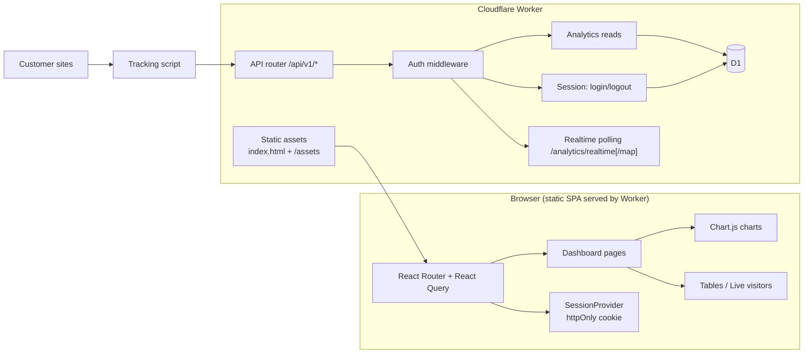

# DataGoat — Dashboard Architecture

Status: proposal (no code yet, no repo created)
Owner: Dashboard Engineer
Stack target: Cloudflare Worker (serves static assets + `/api/v1`) + D1
License: MIT

This proposes how the dashboard is built and how it talks to the API. It aligns
to the API surface in `api.md` (API & Integrations Engineer) — same `/api/v1/`
paths, the `{"data": …}` / `{"error": …}` envelopes, and the realtime polling
endpoints. Ingestion and the D1 schema are the Worker Engineer's remit; this doc
states only what the dashboard needs to read and write.

## 1. Goals and constraints

- Static SPA built at deploy time, served by the same Worker that serves
  `/api/v1`. No separate Node server, no SSR, no build-time data fetching.
- Self-hostable and small: one Worker, one D1, one deploy command.
- Privacy-first: no third-party scripts, fonts, or CDNs at runtime. Everything
  ships with the app.
- Scope from the brief: traffic by source, revenue by source, funnels and goals,
  live visitors, period selector, website switcher.
- Fast first paint: shell renders before data; skeletons, not spinner-only pages.

## 2. Tech stack (decisions)

| Concern | Choice | Why |
|---|---|---|
| UI framework | React 18 + TypeScript | Largest OSS contributor pool; ergonomic for tables, charts, filters. |
| Build tool | Vite (`build.outDir = dist`) | Hashed static assets; Workers static-assets friendly. |
| Routing | `react-router` (history mode) | Deep links per site/period/filter; Worker SPA fallback handles refreshes. |
| Server state | TanStack Query | Caching, dedupe, retries, background refetch for realtime. |
| Chart library | **Chart.js v4** (canvas) + `chartjs-adapter-date-fns` | Tree-shakeable, canvas (no DOM overhead), tiny vs ECharts/D3; line/bar/doughnut/sparkline in one lib. |
| Styling | Hand-written CSS with custom properties (design tokens) | No Tailwind build plugin; small; full control of dark/light. |
| Tables | Native `<table>` + a small sort/paginate hook | Accessible by default; no heavy grid library. |
| Dates | `date-fns` (tree-shakeable) | Timezone-aware period math without a heavyweight locale set. |
| Icons | Inline SVG components | No icon-font/network dependency. |
| Testing | Vitest + Testing Library; Playwright e2e with a mocked `/api/v1` | Unit + contract test against the documented endpoints. |

If live rendering of a high-frequency stream ever gets janky, swap only the live
sparkline to **uPlot** (~35 KB, canvas) and keep Chart.js for everything else. No
Recharts (heavy, SVG/DOM) or ECharts (~1 MB).

## 3. Architecture

- The Worker serves `index.html` for any non-`/api/v1`, non-asset path (SPA
  fallback) and hashed JS/CSS under `/assets/`.
- All data flows through `/api/v1/*`. The browser never touches D1.
- Auth is a same-origin cookie, so no CORS configuration is required.

## 4. API contract the dashboard consumes (from `api.md`)

All calls are `GET` under `/api/v1`, `Accept: application/json`. Lists carry
`pagination: { limit, offset, total, hasMore }`. Common params: `startAt`, `endAt`
(inclusive `YYYY-MM-DD` or ISO), `timezone` (IANA, default site tz), `path`,
`fields`, `interval` (`hour|day|week|month`), `order` (`asc|desc`).

| Dashboard need | Endpoint |
|---|---|
| Website switcher | `GET /api/v1/admin/sites` (`sites:read`) |
| KPI cards | `GET /api/v1/analytics/overview` |
| Timeseries chart | `GET /api/v1/analytics/timeseries` |
| Traffic by source | `GET /api/v1/analytics/referrers`, `/campaigns`, `/pages`, `/countries`, `/devices`, `/browsers` |
| Revenue by source | same breakdown endpoints (`revenue`, `revenuePerVisitor`, `payments`) |
| Funnels | `GET /api/v1/analytics/funnel/{funnelId}`; admin CRUD `/api/v1/admin/sites/{siteId}/funnels` |
| Goals | `GET /api/v1/analytics/goals` |
| Live visitors | `GET /api/v1/analytics/realtime` + `/api/v1/analytics/realtime/map` |
| Site settings (tz, currency, name) | `GET /api/v1/analytics/metadata` |

`GET /api/v1/analytics/overview` returns totals: visitors, sessions, pageviews,
bounce rate, avg session duration, revenue, payments, revenue/visitor,
conversion rate, plus an optional `previous` block mirroring the same fields
for the immediately preceding equal-length range in the site tz (`api.md`
§2.1). Every breakdown endpoint (`pages`, `referrers`, `campaigns`,
`countries`, `devices`, `browsers`, `hostnames`, `goals`, …) returns rows of
`{ value, visitors, pageviews, revenue, payments, revenuePerVisitor, conversionRate }`
(`api.md` §2.1.1). `revenue` is **attributed** revenue per the Attribution
Engineer's model, not booked revenue — the UI must label it as an estimate, and
`revenuePerVisitor` is `revenue / visitors` (0 when visitors = 0).

## 5. Authentication

The API uses `Authorization: Bearer` tokens (`dg_read_`, `dg_ingest_`, `dgt_`)
for CLI, MCP, and external callers — see `api.md` §1. The browser dashboard
does **not** hold a Bearer token in JS, where any XSS could exfiltrate it. The
confirmed design (`api.md` §2.5, resolving its open question #4):

1. Operator sets an admin password at first boot. Stored as a **PBKDF2-SHA256**
   hash (Web Crypto, ≥210k iterations) in D1 — Workers have no Argon2/bcrypt in
   the standard runtime. The Worker Engineer owns that table.
2. `POST /api/v1/session` with `{ password }` verifies the hash and sets an
   **httpOnly, Secure, SameSite=Lax, Path=/, Max-Age=43200** cookie `dg_session`
   containing an HS256 JWT `{ sub, exp, iat }` (12h) signed with `SESSION_SECRET`
   from the Worker env. `POST /api/v1/session/logout` clears it. The JWT secret
   never leaves the Worker; JS cannot read the cookie.
3. `GET /api/v1/session` is the whoami: `{ authenticated: true, scope: "owner" }`
   or 401. The dashboard calls it on load; a 401 redirects to `/login`, which
   returns to the intended URL.
4. The middleware accepts **either** the cookie **or** `Authorization: Bearer`.
   A cookie session maps to **account-owner** scope, so the SPA can call admin
   CRUD (funnels, keys, tokens, team, settings). `dg_*` keys are never accepted
   as the SPA session. Same-origin, so no CORS.
5. Settings → API keys uses the admin endpoints
   (`/api/v1/admin/sites/{siteId}/keys`, `/api/v1/admin/tokens`). Keys are
   created/revoked there and used only by CLI/MCP, never by the SPA.
6. Login is rate-limited (10 attempts / 15 min / IP).

## 6. State management

- **URL is the source of truth** for `site`, `startAt`, `endAt`, active tab, and
  filters. Views are shareable; back/forward works.
- **TanStack Query** holds server data. Every query key includes site + range +
  filters. `staleTime`: overview/timeseries 60s, realtime 0, funnels/goals 5m.
- Envelope handling is centralized in one fetch wrapper: unwrap `data`, surface
  `error.message`, and keep `pagination` for tables.
- **React context** only for cross-cutting UI state (selected site, theme,
  toasts). No global store.
- Filter typing is debounced 250 ms; changing params cancels the stale request
  (same React Query key).

## 7. Component list

Layout: `AppShell` (sidebar nav + top bar) → page → sections.

| Component | Responsibility | Data |
|---|---|---|
| `AppShell` | nav, theme toggle, account menu, 401 redirect | `GET /api/v1/session` |
| `LoginPage` | password form, redirect-back | `POST /api/v1/session` |
| `WebsiteSwitcher` | site dropdown; sets `?site=`; persisted to localStorage | `GET /api/v1/admin/sites` |
| `PeriodSelector` | presets Today/Yesterday/7d/30d/90d/Custom + compare toggle | URL params |
| `KpiGrid` | responsive row of KPI cards | `GET /api/v1/analytics/overview` |
| `KpiCard` | label, value, delta chip, tooltip, skeleton | overview item |
| `TimeseriesChart` | visitors/pageviews/revenue line+bar, hour/day zoom | `GET /api/v1/analytics/timeseries` |
| `SourceTabs` | Referrer / Campaign / Page / Country / Device / Browser tabs | local |
| `SourceChart` | top-N horizontal bar or doughnut for the active dimension | breakdown endpoint |
| `SourceTable` | sortable, paginated rows with sparkline column | breakdown endpoint |
| `FunnelList` | saved funnels + "new funnel" | `GET /api/v1/admin/sites/{siteId}/funnels` |
| `FunnelBuilder` | name steps, pick page/goal per step | `POST/PATCH …/funnels` |
| `FunnelChart` | per-step bars, conversion %, revenue per step | `GET /api/v1/analytics/funnel/{funnelId}` |
| `GoalList` | goals and totals | `GET /api/v1/analytics/goals` |
| `LiveVisitorsPanel` | online count, live list (page, referrer, country, device), live sparkline | `GET /api/v1/analytics/realtime` + `/map` |
| `DataTable` (shared) | generic sortable/paginated table + empty state | any list |
| `ChartTooltip`, `Skeleton`, `ErrorState`, `EmptyState` | shared UI | — |
| `SettingsPage` | API keys, team members, site metadata | admin endpoints + `/analytics/metadata` |

Funnel steps are predicates (`api.md` §2.6): page equals/contains, goal,
country, referrer, device, hostname, UTM source/campaign, isCustomer, and scroll
depth (dropped with a warning when scroll events don't exist). Steps are
ordered within one session, 2–8 per funnel, with optional `maxGapSeconds`; a
payment step is the goal `payment`. The dashboard only renders results; the
Worker computes them.

## 8. Period selector, website switcher, and deltas

- Presets are relative to **now** in the site's timezone (`GET
  /api/v1/analytics/metadata` supplies it): Today, Yesterday, Last 7/30/90 days,
  and a custom range from two `<input type="date">` fields.
- Selecting a preset writes `?startAt=&endAt=` to the URL and refetches each
  active query once.
- **Compare to previous period**: with the toggle on, the dashboard requests
  the `previous` block from `overview` (`api.md` §2.1) — one request, same
  tz/range math — and renders delta chips from it. If the block is not yet
  deployed, the client falls back to a second fetch of the prior equal-length
  range and computes the deltas; M1 is not blocked either way.
- The website switcher is a combobox; choosing a site updates `?site=` and
  resets filters that do not apply. Last choice is remembered in `localStorage`,
  but the URL wins when present.

## 9. Live visitors

`api.md` ships polling endpoints, so live visitors poll, not stream:

- `GET /api/v1/analytics/realtime` every **10 s** → active visitor count.
- `GET /api/v1/analytics/realtime/map` every **10 s** → active visitors over the
  last ~10 min with current page and recent payments, for the live list and the
  optional map.
- The panel shows an "online" count, a live list (page, referrer, country,
  device, time), and a small live sparkline of the count.
- If the Worker later adds SSE for realtime, the same panel swaps its transport;
  the component interface does not change.

## 10. Feature parity target (grounded, not invented)

Scope comes from the brief. Reference surfaces used to shape the UI, both read
publicly on 2026-11-02:

- **DataFast** (datafa.st docs): conversion funnels with revenue attribution and
  per-step source/country breakdown; goals and journeys; live visitor
  intelligence; websites, funnels, alerts, team members, integrations, API keys,
  CLI and MCP. Funnels support page-URL steps and hover metrics.
- **DataBull** (databull.app): revenue by source across channel, referrer,
  campaign, landing page, country and device; realtime visitors with a live map;
  goals and funnels that end at the payment; peak hours; path to purchase; LTV by
  first source. Its dashboard shows KPI cards (Visitors, Revenue, Conversion,
  Revenue/visitor, Bounce rate, Session time, Online) over a Today/7d/30d
  selector, with Channel/Referrer/Campaign tabs and Page Entry/Exit tables.

DataGoat implements the brief's named scope with **original** code and labels. We
copy no markup, styles, or copy from either product.

## 11. Performance, accessibility, security

- Code-split per route and lazy-load chart components (`React.lazy`); initial
  bundle target < 150 KB gz, measured in CI.
- Tables use `limit`/`offset` from the API (default 25–100) and paginate
  server-side — never load a full referrer list.
- Accessibility: real tables with `<th scope>`, sortable headers expose
  `aria-sort`, charts have text summaries and a data-table fallback, visible
  focus states, dark/light respects `prefers-color-scheme`, motion respects
  `prefers-reduced-motion`, color-blind-safe categorical palette.
- Security: strict CSP (`default-src 'self'; img-src 'self' data:`), no inline
  scripts, no third-party origins, hashed-asset long cache, login rate limiting,
  no secrets in the client bundle, JWT/session secret only in Worker env.

## 12. Milestones

- **M0** — static shell, router, session auth (login/logout, cookie, 401 flow),
  app skeleton, theme tokens, CI build.
- **M1** — KPI grid + timeseries from `/analytics/overview` and
  `/analytics/timeseries`; period selector wired to URL; delta chips from the
  `previous` block (second-fetch fallback).
- **M2** — source tabs, source chart + table, website switcher, filters.
- **M3** — funnels list/builder/results and goals list.
- **M4** — live visitors (realtime + realtime/map polling) + online count.
- **M5** — settings (API keys, team, metadata), a11y audit, perf budget, docs.

## 13. Resolved and open

Resolved with the API & Integrations Engineer on 2026-11-02 (`api.md` §2.1,
§2.1.1, §2.5, §2.6, §9 Q4):

- **SPA session**: `POST /api/v1/session` (+ `/session/logout`, `GET /session`),
  httpOnly `dg_session` cookie, owner scope; middleware accepts cookie or
  Bearer. `api.md` §2.5.
- **Deltas**: `overview` gains an optional `previous` block; the client-side
  second-fetch is the fallback. `api.md` §2.1.
- **Funnel predicates**: page equals/contains, goal, country, referrer, device,
  hostname, UTM source/campaign, isCustomer, scroll depth (dropped with a
  warning when scroll events don't exist); 2–8 steps, ordered within one
  session, optional `maxGapSeconds`; payment step = goal `payment`. `api.md` §2.6.
- **Breakdown rows**: `{ value, visitors, pageviews, revenue, payments,
  revenuePerVisitor, conversionRate }`; revenue is attributed (estimate).
  `api.md` §2.1.1.

Still open:

- **Realtime**: polling `/analytics/realtime` + `/realtime/map` every 10 s
  matches the current contract; confirm SSE is not needed for v0.
- **Timezone**: confirm `timezone` defaults to the site tz from
  `/analytics/metadata` and that `startAt`/`endAt` are inclusive (a date-only
  bound covers the whole local day).

## 14. Sources

- DataFast docs — conversion funnels: https://datafa.st/docs/conversion-funnels
- DataFast product/features: https://datafa.st/
- DataFast API docs: https://datafa.st/docs/api
- DataBull product: https://databull.app/
- DataBull vs DataFast: https://databull.app/alternatives/datafast
