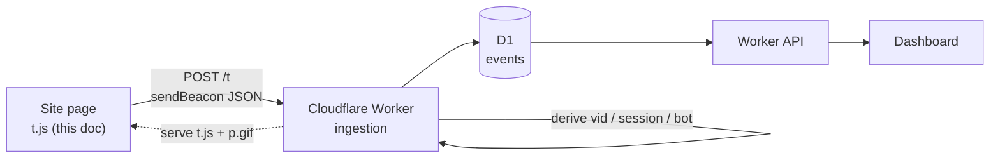
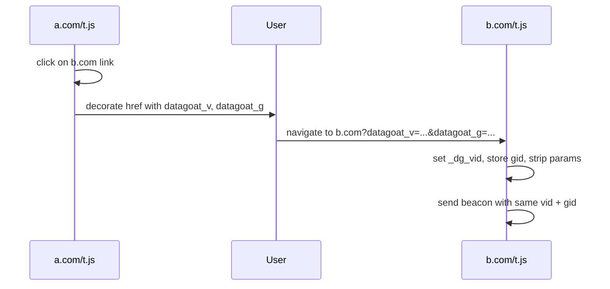

# DataGoat Tracking Script — Design Proposal

Status: **proposal** (no repo, no app code yet)
Owner: Script & SDK Engineer
Consumers: Worker Engineer (ingestion + D1 schema), Dashboard Engineer (metrics), OSS Maintainer (repo/license)
Version: **v1.1** — aligned with `worker.md` §5.1/§5.6/§7/§11 (2026-11-02). All blocking items resolved.

---

## 0. Scope

This document covers the **client-side tracking script** only:

- the single `<script>` tag install and its configuration
- the beacon payload sent to the Worker
- visitor id strategy (cookie mode and cookieless mode)
- session handling (client hint + server authority)
- bot filtering on the client (plus a note on server authority)
- cross-domain and subdomain tracking
- the npm package surface (React Native SDK is explicitly out of scope for v1)

Out of scope: the Worker route, the D1 schema, the dashboard UI, the ingestion API beyond the endpoint contract in §3, and the React Native SDK.

---

## 1. Principles

1. **No dependencies.** Plain ES2017 JavaScript, no framework, no bundler needed for the core. Target < 5 KB gzipped.
2. **Never block the page.** Always load async (`defer` / dynamic script), never synchronous, never render-blocking.
3. **Server is authoritative.** The client sends signals (visitor id, bot score, dimensions); the Worker decides what is stored, sessionized, filtered, and geo-enriched. The client never writes D1.
4. **Privacy by default.** No third-party cookies, no cross-site tracking, no fingerprinting without consent. Cookieless mode is a first-class option.
5. **Small payload, few requests.** One beacon per pageview; batch custom events when possible; use `sendBeacon` so the send survives unload.
6. **No PII in the payload.** The script never sends form field values, input text, or URL path parameters that look like PII (see §9).

---

## 2. Architecture



Two HTTP shapes:

| Shape | Path | Purpose |
|---|---|---|
| JSON beacon | `POST /t` | pageviews + custom events from `t.js` |
| Pixel | `GET /p.gif` | `<noscript>` fallback and lightweight pageview |

Both are served by the Worker (static asset for `t.js`, request handler for `/t` and `/p.gif`).

---

## 3. Endpoint contract (for the Worker Engineer)

This is the contract the Worker must implement so the script and D1 schema line up.

### 3.1 `POST /t`

The only browser write path. `text/plain` is CORS-safelisted, so `navigator.sendBeacon` needs no preflight; the body is still JSON. Returns `204 No Content` (never a body), `Cache-Control: no-store`, `Access-Control-Allow-Origin: *`, and `204` to `OPTIONS`. Accepted content types: `text/plain;charset=UTF-8` (beacon default), `application/json` (fetch/XHR), `image/gif` (legacy, §3.2).

Validation (from `worker.md` §5.1, authoritative):

1. `s` resolves to `websites.site_token`, else `404`.
2. Host of `u` is in `allowed_hosts` (or equals `domain`), else `400 host_not_allowed`.
3. `e` in (`pageview`,`event`); for `e=event`, `props.name` is required and becomes `events.name`.
4. `ts` within ±24h of server time after converting wire **ms → s**; else `400`.
5. Dedup key `event_id` (§4.1): a repeat returns `204` no-op.
6. Rate limit per `(website_id, ip)` and per `website_id`; over limit → `204` (never retry) and counted.
7. `ts` older than `retention_days` is accepted but flagged.

Server-side enrichment (never trust the client): `country`/`region`/`city`/`colo` from `request.cf`, `device_type`/`os`/`browser` from UA, `is_bot`/`bot_reason`/`bot_score`, `channel`/`channel_name`/`direct_type`, UTM, `session_id`, `created_at`, and `visitor_id` when `vid` is absent. `session_id` is stamped from `visitor_id` + a 30-minute bucket (§6); the client `sid` is ignored when it disagrees with the server window.

### 3.2 `GET /p.gif`

Deprecated in v1, kept for `<noscript>` parity. Query params mirror the pageview subset: `s`, `u`, `p`, `q`, `r`, `vw`, `vh`, `sw`, `sh`, `dpr`, `lang`, `tz`, `e`, `props` (URL-encoded JSON). Returns a 1×1 transparent GIF. Server derives `vid` cookieless (no cookie available in `<noscript>`), sessions, bot, geo as in §3.1.

### 3.3 Static `GET /t.js`

- Served from the same Worker host so the install is one origin: `https://<host>/t.js`.
- `Cache-Control: public, max-age=300, stale-while-revalidate=86400` (allow short caching; version via `t.js?v=<semver>` when needed).
- Script responsibilities (aligned with `worker.md` §5.2): read UTM from the URL and store first-touch in a first-party cookie; emit `pageview` on load and on SPA route change (`pushState`/`popstate`); emit `scroll` at 25/50/75/100% depth; expose `window.datagoat('trackPageview'|'trackEvent'|'identify'|'reset'|'consent')`; honor `data-require-consent="true"` (nothing stored until the banner fires).

---

## 4. Beacon payload

One JSON envelope for pageviews and custom events. Keys are short but reserved; custom data goes under `props` and must not collide with them.

```json
{
  "v": 1,
  "s": "site_token",
  "e": "pageview",
  "ts": 1761904800123,
  "u": "https://example.com/pricing?plan=pro",
  "p": "/pricing",
  "q": "plan=pro",
  "r": "https://google.com/",
  "vid": "9f2c1e0ab74d4f3c8e5a6b7c8d9e0f11",
  "sid": "base64url-22-chars",
  "uid": "user@example.com",
  "vw": 1280,
  "vh": 800,
  "sw": 1440,
  "sh": 900,
  "dpr": 2,
  "lang": "en-US",
  "tz": "Europe/Berlin",
  "bs": 0,
  "pvid": "a1b2c3d4e5f60718",
  "event_id": "a1b2c3d4e5f60718",
  "gid": "0f1e2d3c4b5a6978",
  "props": {}
}
```

### 4.1 Field table

| Key | Type | Required | Meaning |
|---|---|---|---|
| `v` | int | yes | payload schema version (start at `1`) |
| `s` | string | yes | site token from `data-site` |
| `e` | string | yes | `pageview` or `event` |
| `ts` | int | yes | client epoch **ms** on the wire; the Worker converts to unix **s** for D1 (`ts/1000`) |
| `u` | string | yes | full URL, path + query; **path and query are redacted per §9** |
| `p` | string | yes | path only (`/pricing`) |
| `q` | string | no | query string without `?` |
| `r` | string | no | `document.referrer` (empty on direct) |
| `vid` | string | no | visitor id; **omitted in cookieless mode** |
| `sid` | string | no | session hint; ignored when it disagrees with the server window (§6) |
| `uid` | string | no | logged-in user id after `identify()`; the Worker stores `sha256(uid + install_secret)` and never logs the raw value (§5.4) |
| `vw`,`vh` | int | yes | viewport inner width/height |
| `sw`,`sh` | int | yes | screen width/height |
| `dpr` | number | no | device pixel ratio |
| `lang` | string | no | `navigator.language` |
| `tz` | string | no | `Intl.DateTimeFormat().resolvedOptions().timeZone` |
| `bs` | int | yes | client bot score 0–100 (§7) |
| `pvid` | string | yes | random 16-hex per pageview; groups that pageview's events (`scroll`, `reading_time`). **Not** the dedup key. |
| `event_id` | string | yes | per-event idempotency key (§4.1): `pvid` for the pageview, `pvid + ":" + sha256(props.name + ts).slice(0,8)` for custom events |
| `gid` | string | no | cross-domain link group id (§8) |
| `props` | object | no | custom event properties (§4.2) |

### 4.2 Custom event example

```json
{
  "v": 1, "s": "site_token", "e": "event", "ts": 1761904810000,
  "u": "https://example.com/pricing", "p": "/pricing", "q": "",
  "r": "", "vid": "...", "vw": 1280, "vh": 800, "sw": 1440, "sh": 900,
  "bs": 0, "pvid": "b2c3d4e5f6071829", "event_id": "b2c3d4e5f6071829:3f9a1c",
  "props": { "name": "signup", "plan": "pro", "value": 49 }
}
```

Reserved `name` values (from `worker.md` §6): `pageview`, `scroll`, `reading_time`, `identify`, and any goal slug. Custom events use the goal slug so `goals` and `events` join without a mapping table.

Automatic events the script emits on a pageview (all share the pageview's `pvid` and get their own `event_id`):

| Event | Trigger | `props` |
|---|---|---|
| `pageview` | load / SPA route change | `{}` |
| `scroll` | 25 / 50 / 75 / 100% depth | `{ scroll_depth: 25 }` |
| `reading_time` | on unload / next event | `{ reading_time_ms: 4200 }` |

Rules for `props`:
- Values must be string, number, or boolean (no nested objects in v1; flatten or JSON-stringify).
- Keys are lowercased and truncated to 64 chars; values truncated to 255 chars.
- The event **name** is `props.name`; it becomes `events.name` (a goal slug for goals).
- Reserved keys (`v`,`s`,`e`,`ts`,`u`,`p`,`q`,`r`,`vid`,`sid`,`uid`,`vw`,`vh`,`sw`,`sh`,`dpr`,`lang`,`tz`,`bs`,`pvid`,`event_id`,`gid`,`props`) cannot appear at the top level of `props`.

---

## 5. Visitor ID strategy

Two modes, plus a fallback chain. The mode is set at install time (§10) or auto-detected.

### 5.1 Cookie mode (default)

- Cookie `_dg_vid` = 32-char lowercase hex (16 random bytes, `crypto.getRandomValues`).
- Attributes: `Path=/`, `Secure` (when page is https), `SameSite=Lax` (or `None` for cross-site iframe embeds), `Expires` = +1 year, rolling.
- **Readable by the script (not `HttpOnly`)** — confirmed by the Worker Engineer (`worker.md` §11, 2026-11-02): the script must read `_dg_vid` to send `vid`, and an `HttpOnly` id would silently degrade every cross-origin install to cookieless. Keep `Secure` and `SameSite=Lax` (use `SameSite=None; Secure` only for cross-site iframe embeds). `_dg_ses` stays `HttpOnly` (hint only). Accepted XSS trade-off: the id is a random 32-hex value with no PII.
- `Domain`:
  - omitted (host-only) by default, or
  - set to the registrable domain (e.g. `.example.com`) when subdomain tracking is on (§8.1).
- Session cookie `_dg_ses` = `base64url(vid + ":" + sessionStartEpoch)`, `SameSite=Lax`, 30-min sliding, `Max-Age=1800`. Used as a fast hint; the Worker still recomputes sessions (§6).
- The script reads `_dg_vid` on load; if missing, generates and sets it. It never overwrites an existing value (that is how a returning visitor is recognized).
- First-touch cookie `_dg_utm` stores the first non-utm referrer/UTM set for the session (read by `worker.md` §5.2).

### 5.2 Cookieless mode

No cookie, no `localStorage` id. The client **omits `vid`**. The Worker derives it (adopted verbatim from `worker.md` §11):

```
vid = hex( HMAC_SHA256( install_secret, site_token + ip + user_agent + day_bucket ) )
```

- `day_bucket` = `YYYY-MM-DD` in the site's timezone (UTC if unknown), so a person is stable within a day and resets daily.
- `install_secret` = a **per-install** Worker secret (not per-site). The Worker stores a `secret_version` integer alongside the derived id; rotating the secret resets all cookieless ids by design.
- Trade-off (document it in the dashboard): the same person on two devices = 2 visitors; a person who changes network but keeps the same browser+UA = a new visitor. This is the accepted privacy/accuracy trade-off and matches the "cookieless" promise.

### 5.3 Fallback chain (auto mode)

Maps to `websites.privacy_mode` (`cookies | cookieless | consent`). When `data-mode="auto"` (default), the script tries in order and stops at the first that works:

1. `_dg_vid` cookie — read if present, else set. (Falls back to `localStorage["_dg_vid"]` if cookies are blocked; the Worker treats it the same — it just receives `vid`.)
2. If both cookie and `localStorage` are blocked → cookieless: omit `vid`; the Worker derives it (§5.2).
3. If `data-consent="true"` (or `data-require-consent="true"`), the script starts cookieless and upgrades to cookies only after `datagoat('consent', { analytics: true })`.

`data-mode="cookies" | "cookieless"` forces a mode. `data-cookieless="true"` is a shortcut for `data-mode="cookieless"`.

### 5.4 Identification (`identify()`)

- `datagoat('identify', '<user id>')` sets `uid` on every subsequent event.
- The Worker stores `visitors.identified_user = sha256(uid + install_secret)` and **never logs the raw value** (`worker.md` §5.6/§11). A site that wants zero PII on the wire may pre-hash `uid` client-side (64-hex); the Worker accepts both.
- Logged-in users are grouped across devices **only when the site calls `identify()`**; it must not be used to deanonymize cookieless visitors.
- `datagoat('reset')` clears the visitor/session cookies and local storage (for logout).

---

## 6. Session model

- **Authoritative sessionization is server-side.** The Worker computes `session_id` from `visitor_id` + event time using a **30-minute inactivity window** (new session when the gap since the visitor's last event > 30 min, or at midnight, or when `referrer` is an external domain on a new visit). Midnight split is configurable, **default off** (`worker.md` §12.1).
- The client `sid` cookie is only a hint; the Worker recomputes and ignores a hint that disagrees with its own window. Ingest stamps `session_id` so a session's events are contiguous; the `sessions` table is derived in rollup.
- `is_new_visitor` / `is_new_session` flags are computed by the Worker and stored, so the dashboard does not need to reconstruct them.

---

## 7. Bot filtering

The client sends a **signal**; the Worker makes the **decision**.

### 7.1 Client signal (`bs`, 0–100)

Heuristics run at load (cheap, no network):

| Check | Points |
|---|---|
| `navigator.webdriver === true` | 100 |
| UA matches known bot/crawler/spam regex | 100 |
| `navigator.plugins.length === 0` **and** headless Chrome markers (`window.chrome` missing, `navigator.languages` empty) | 60 |
| `window.outerWidth === 0 && window.outerHeight === 0` | 40 |
| `Intl.DateTimeFormat().resolvedOptions().timeZone` missing | 20 |
| `document.hidden` at load and no interaction in 2 s | 10 |

- If `data-block-bots="true"` and `bs >= data-bot-threshold` (default 60), the script **does not send** the pageview.
- The `bs` value is always sent when the pageview is sent, so the Worker can re-judge.

### 7.2 Server authority (Worker)

The Worker is authoritative; `websites.bot_filter_level` is `off | standard | strict` (default `standard`). Rules run in order, first match wins, and set `bot_reason` (`worker.md` §7):

- UA known-bot list (`src/data/bots.txt`, versioned), missing/empty UA, headless markers (`HeadlessChrome`, `PhantomJS`, `Puppeteer`, `Selenium`, `Playwright`, `webdriver`), missing `accept`/`accept-language`, `excluded_ips`, `excluded_paths` (glob patterns), `excluded_ua` (regex fragments), datacenter ASN (`strict` only), honeypot visitor `dg_bot_trap`, UA device type `bot`.

Behavior: at `standard`/`strict`, bot events are **not written** to `events` and no `sessions`/`visitors` rows are created. At `off`, everything is written with `is_bot = 1` so the dashboard can show bot traffic (parity with DataFast). The dashboard excludes bots by default. **Never trust the client alone.**

---

## 8. Cross-domain and subdomain tracking

### 8.1 Subdomain tracking (same registrable domain)

- Set `data-domain=".example.com"` (or let the script auto-detect by dropping the leftmost label when the rest still contains a dot).
- The `_dg_vid` cookie is written with `Domain=.example.com`, so `app.example.com` and `www.example.com` share one visitor.
- `SameSite=Lax` is enough for top-level navigation between subdomains; use `SameSite=None; Secure` only when the site is embedded cross-site.
- No extra beacon is needed; the shared cookie carries the id.

### 8.2 Cross-registrable-domain tracking

Cookies cannot cross registrable domains, so v1 uses **link decoration**:

1. Site owner lists trusted partners: `data-cross-domain="shop.example.net,docs.example.org"`.
2. On a click (or `mousedown` for middle-click) on a link whose hostname is in that list, the script appends `?datagoat_v=<vid>&datagoat_g=<gid>` to the href (`gid` is a random group id stored in `localStorage`, shared across the partner sites).
3. The destination site's script reads those params on load, sets its own `_dg_vid` to the incoming `datagoat_v` (only if the destination is also a DataGoat site and the param is present), stores `gid`, then removes the params with `history.replaceState`.
4. Subsequent events on both domains carry the same `vid` and `gid`, so the Worker can stitch the two sites' journeys under one `gid`.



**Optional v2:** a central sync domain (`crossDomain.syncUrl`) that sets a cookie on a neutral first-party domain via a 1×1 redirect. This avoids decorating every link but adds a redirect; we defer it.

### 8.3 Same-site iframes / embeds

- If the embed is same-site, the parent can pass the visitor id via `postMessage` or a URL param, or simply rely on the shared subdomain cookie.
- Cross-site iframes require `SameSite=None; Secure` cookies and explicit `data-allow-embed="true"`; we do not track inside cross-site iframes by default.

---

## 9. Privacy, consent, DNT

- **DNT/GPC**: when `data-respect-dnt="true"` (default) and `navigator.doNotTrack === "1"` or `navigator.globalPrivacyControl === true`, the script defaults to cookieless mode and still tracks (privacy-respecting) unless the site owner set `data-dnt="block"`.
- **Consent**: if the site has a consent banner, call `datagoat('consent', { analytics: true|false })` before the first pageview, or use `data-require-consent="true"` so the script waits for a `window.__datagoat_consent` flag. This is the `privacy_mode = consent` path in `worker.md` §11: cookieless until consent, then cookies. `events.consent` records `1 | 0 | NULL`.
- **UTM / first-touch**: the script reads UTM from the URL and stores first-touch in a first-party cookie (`_dg_utm`); the Worker derives `channel`/`channel_name`/`direct_type` server-side (`worker.md` §8).
- **URL redaction**: by default the script strips query keys that look like PII (a configurable list: `email`, `token`, `password`, `api_key`, etc.) and truncates the path/query to 512 chars. `data-redact-url="false"` disables (site owner's responsibility).
- **Exclusions**: `data-exclude="/admin/*,/checkout/*"` produces glob patterns stored in `websites.excluded_paths` and matched by the Worker.
- **Never sent**: form input values, `window.name`, `localStorage` contents other than the visitor id, `document.cookie` from other origins, keystrokes.
- **Retention**: the Worker owns retention (`websites.retention_days`, default 365); the script has no retention logic.

---

## 10. Install snippets

All snippets use `<worker-host>` = the site's DataGoat Worker host and `<SITE_TOKEN>` = the site token from the dashboard.

### 10.1 Default (async, auto mode)

```html
<script src="https://<worker-host>/t.js" data-site="<SITE_TOKEN>" defer></script>
```

### 10.2 Configured (subdomain + exclusions + SPA off)

```html
<script
  src="https://<worker-host>/t.js"
  data-site="<SITE_TOKEN>"
  data-domain=".example.com"
  data-mode="cookies"
  data-auto-track="true"
  data-spa="false"
  data-hash="false"
  data-exclude="/admin/*,/checkout/*,/api/*"
  data-respect-dnt="true"
  data-require-consent="false"
  data-block-bots="true"
  data-bot-threshold="60"
  data-redact-url="true"
  defer
></script>
```

> `scroll` (25/50/75/100%) and `reading_time` are emitted automatically; no snippet config needed.

### 10.3 Cookieless (privacy-first)

```html
<script src="https://<worker-host>/t.js" data-site="<SITE_TOKEN>" data-cookieless="true" defer></script>
```

### 10.3b Consent-gated (cookieless until the banner fires)

```html
<script src="https://<worker-host>/t.js" data-site="<SITE_TOKEN>" data-require-consent="true" defer></script>
<script>
  // call from your consent banner:
  datagoat('consent', { analytics: true });
</script>
```

### 10.4 SPA (React/Vue/Svelte/Next)

```html
<script src="https://<worker-host>/t.js" data-site="<SITE_TOKEN>" data-spa="true" defer></script>
<script>
  // after every client-side route change:
  datagoat('trackPageview');
</script>
```

### 10.5 Queue before the script loads (recommended)

```html
<script>
  window.datagoat = window.datagoat || function () {
    (window.datagoat.q = window.datagoat.q || []).push(arguments);
  };
</script>
<script src="https://<worker-host>/t.js" data-site="<SITE_TOKEN>" defer></script>
```

### 10.6 Custom events and identify

```js
// any time after load
datagoat('trackEvent', { name: 'signup', plan: 'pro', value: 49 });
datagoat('identify', 'user@example.com');   // logged-in user id
datagoat('setUserProperties', { plan: 'pro' });
```

### 10.7 No-JS fallback

```html
<noscript>
  /p.gif?s=<SITE_TOKEN>&u=/pricing&e=pageview" alt="" width="1" height="1" />
</noscript>
```

### 10.8 Cross-domain

```html
<script
  src="https://<worker-host>/t.js"
  data-site="<SITE_TOKEN>"
  data-domain=".example.com"
  data-cross-domain="shop.example.net,docs.example.org"
  defer
></script>
```

### 10.9 Manual (no auto pageview)

```html
<script src="https://<worker-host>/t.js" data-site="<SITE_TOKEN>" data-auto-track="false" defer></script>
<script>datagoat('trackPageview', { url: location.href });</script>
```

---

## 11. Client API surface

Global `window.datagoat(command, ...args)`, backed by a pre-load queue (`window.datagoat.q`).

| Command | Args | Effect |
|---|---|---|
| `trackPageview` | `{ url? }` | send a `pageview` event; defaults to current URL |
| `trackEvent` | `{ name, ...props }` | send an `event` with `props.name` |
| `identify` | `<userId>` | set `uid` on subsequent events |
| `setUserProperties` | `{ ...props }` | attach to subsequent events |
| `consent` | `{ analytics: boolean }` | enable/disable tracking per consent |
| `reset` | — | clear visitor/session cookies and storage |
| `optOut` | — | disable tracking for this browser until `reset` |
| `setDomain` | `<domain>` | change the cookie `Domain` at runtime |

Return value: a promise resolving to `true`/`false` (whether the beacon was queued). All commands are non-throwing. `scroll` (25/50/75/100%) and `reading_time` are emitted automatically and are not called by site code.

---

## 12. npm package (surface only)

Package name: **`datagoat`** (or scoped `@datagoat/browser`). Same payload and commands as §4/§11, plus:

```bash
npm install datagoat
```

```js
import DataGoat from 'datagoat';

DataGoat.init({
  site: '<SITE_TOKEN>',
  endpoint: 'https://<worker-host>',
  domain: '.example.com',
  cookieless: false,
  respectDnt: true,
  blockBots: true,
  exclude: ['/admin/*'],
});

DataGoat.trackEvent('signup', { plan: 'pro' });
DataGoat.identify('user@example.com');
```

- Framework helpers (thin wrappers, no logic): `useDataGoat()` for React, `datagoat` plugin for Vue, `DataGoatModule` for Nuxt.
- The npm package loads the same core as `t.js`; it does not reimplement the protocol.
- React Native SDK: **separate package** (`react-native-datagoat`), later; it reuses the payload contract but has no cookies/DOM, so it uses a device-install id stored in app storage.

---

## 13. Decisions and open items

Resolved with the Worker Engineer (2026-11-02, `worker.md` §12.1):

1. Endpoint paths: `POST /t`, `GET /p.gif`, static `GET /t.js`. `/api/ingest/payment*` and `/api/v1/*` stay server-to-server. ✓
2. Cookie prefix `_dg_`. ✓
3. Session window 30 min, server-authoritative; midnight split configurable, default off. ✓
4. Cookieless hash: `HMAC-SHA256(install_secret, site_token + ip + ua + day_bucket)` with a `secret_version`. ✓
5. Bot threshold: client `bs` default 60 is a pre-filter; the Worker stays authoritative (`bot_filter_level`). ✓
6. D1 columns: `events` extended with `bot_score`, `group_id`, `colo`, `viewport_w/h`, `dpr`, `tz`, `is_new_visitor`, `is_new_session`; `websites` gains `site_token`; `visitors` gains `group_id`; `sessions` gains `is_new_visitor`. ✓
7. Geo: `request.cf.country` only, no external GeoIP lookup. ✓
8. Dedup key is a per-event `event_id`, not the per-pageview `pvid`. ✓
9. `_dg_vid` is **not `HttpOnly`** (the script reads it; `_dg_ses` stays `HttpOnly`); `Secure` + `SameSite=Lax` kept. ✓

No open items remain. The script design (`script.md` v1.1) and the Worker contract (`worker.md`) now agree.

---

## 14. Non-goals for v1

- No Heatmaps/session replay.
- No error monitoring, A/B testing, or surveys.
- No third-party or cross-site tracking.
- No Real-time sub-second dashboard (the Worker can still buffer, but the dashboard is near-real-time).
