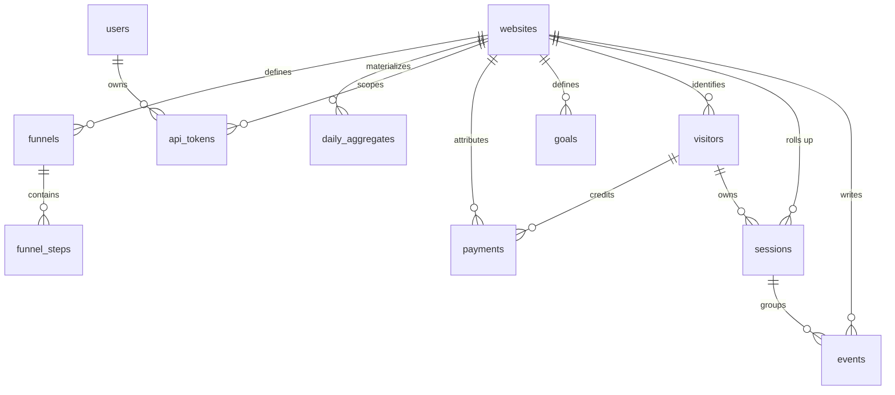

# DataGoat Worker + D1 — Proposed Schema and Ingestion Design

Status: proposal, not implemented. Author: Worker Engineer (DataGoat).
Scope of this document: the Cloudflare Worker (ingestion + read-only API) and the D1 schema.
Out of scope here: repo scaffolding, wrangler config, dashboard HTML, app code. OSS Maintainer owns the repo.
License: MIT. This is original work; databull.app is used only as a feature-parity reference.

---

## 1. What this design must deliver

Feature-parity targets come from the public databull.app pages fetched 2026-11-01 (home, /docs, /docs/install).
Everything below is original design; nothing is copied from their source (their source is not included in the product, per their FAQ).

| Parity area | Source evidence | What the Worker/D1 must support |
| --- | --- | --- |
| One script tag, per-website id + domain | databull.app/docs step 2 | `POST /t`, per-`site_token` allow-list of domains |
| Source per visit: channel, referrer, campaign, landing page, country, device | home | attribution columns on `events`/`sessions`, UTM parse |
| Realtime visitors, live map | home | `sessions` + `visitors`, last-seen index, `GET /api/v1/analytics/realtime` (`api.md` §2.1) |
| Revenue by channel/referrer/campaign/page, next to visitors | home | `payments` + attribution snapshot, joins to sessions/visitors |
| Payments, renewals, refunds; last-non-direct, first-touch, last-touch credit | home | `payments.status` + `attribution_model` per website |
| Peak hours: visits, sales, revenue by weekday + hour in site timezone | home | `daily_aggregates` + a per-hour aggregate kind |
| Scroll depth and reading time per page | home | `events.props` + `sessions.duration` |
| Path to purchase: days/visits before first purchase | home | `visitors.first_purchase_at`, `visitors.days_to_purchase` |
| Readable Direct: typed, shared link, checkout return | home | `direct_type` column + classification rules |
| In-app browsers and AI assistants as their own sources | home | `channel = 'app'` / `channel = 'ai'` classification |
| Lifetime value by first source | home | `visitors.first_channel`, `visitors.ltv_cents` |
| Goals and funnels that end at the payment | home | `goals`, `funnels`, `funnel_steps`, `events.name` |
| Telegram alerts, chart notes | home | out of Worker scope except the trigger table; notes -> `notes` |
| Cookieless / first-party cookie / cookieless-until-consent, bot filtering | home | `websites.privacy_mode`, `visitor_id` derivation, bot rules |
| Read-only API keys, CLI/MCP | home, /docs/mcp | `api_tokens` table + token-scoped read routes |
| Payments API + provider webhooks | home | `POST /api/v1/ingest/payment`, `POST /api/v1/ingest/payment/:provider` |
| Switch from DataFast with one tag (`data-fast-goal`, `window.datafast()`, `datafast_visitor_id`) | home | accepted event aliases, see §7.4 |

Not copied: their installer, license system, hosted product, Telegram integration details, MCP implementation. Those are product decisions for OSS Maintainer, not this document.

---

## 2. Data model overview



Write amplification note: `events` is append-only and the only hot table. `sessions`, `visitors`, and `daily_aggregates` are derived by a cron-triggered rollup, not synchronously in the ingest path (see §9). D1 is single-writer SQLite; keeping ingest to one upsert per beacon is deliberate.

---

## 3. Tables

All timestamps are `INTEGER` unix **seconds** (not ms) unless noted. `JSON` means a `TEXT` column holding serialized JSON, parsed in the Worker — D1/SQLite JSON1 is available but we avoid depending on it for the hot path.
No `FOREIGN KEY` constraints: D1 does not enforce them unless `PRAGMA foreign_keys = ON`, and enforcement is not needed because referential integrity is checked in the Worker.

### 3.1 `websites`

```sql
CREATE TABLE websites (
  id                TEXT PRIMARY KEY,            -- internal, wrk_site_01J...
  site_token        TEXT NOT NULL,               -- public token from data-site; the ingest key
  name              TEXT NOT NULL,
  domain            TEXT NOT NULL,               -- canonical host, no scheme
  timezone          TEXT NOT NULL DEFAULT 'UTC',
  currency          TEXT NOT NULL DEFAULT 'USD',
  owner_user_id     TEXT,                        -- links to users (auth owner)
  privacy_mode      TEXT NOT NULL DEFAULT 'cookies', -- cookies | cookieless | consent
  allow_cookieless  INTEGER NOT NULL DEFAULT 1,
  allowed_hosts     TEXT NOT NULL DEFAULT '[]',  -- JSON array; ingest rejects others
  excluded_ips      TEXT NOT NULL DEFAULT '[]',  -- JSON array of CIDRs/IPs
  excluded_paths    TEXT NOT NULL DEFAULT '[]',  -- JSON array of glob patterns (/admin/*)
  excluded_ua       TEXT NOT NULL DEFAULT '[]',  -- JSON array of regex fragments
  hash_paths        INTEGER NOT NULL DEFAULT 0,  -- strip query/hash from path grouping
  attribution_model TEXT NOT NULL DEFAULT 'last_non_direct', -- last_non_direct | first_touch | last_touch
  retention_days    INTEGER NOT NULL DEFAULT 365,
  bot_filter_level  TEXT NOT NULL DEFAULT 'standard', -- off | standard | strict
  created_at        INTEGER NOT NULL,
  updated_at        INTEGER NOT NULL
);
CREATE UNIQUE INDEX idx_websites_domain ON websites (domain);
CREATE UNIQUE INDEX idx_websites_token ON websites (site_token);
```

### 3.2 `users` (dashboard owner; auth is OSS Maintainer's call)

```sql
CREATE TABLE users (
  id             TEXT PRIMARY KEY,
  email          TEXT NOT NULL,
  password_hash  TEXT NOT NULL,                  -- argon2id / scrypt, never plaintext
  display_name   TEXT,
  is_owner       INTEGER NOT NULL DEFAULT 0,
  created_at     INTEGER NOT NULL,
  last_login_at  INTEGER
);
CREATE UNIQUE INDEX idx_users_email ON users (email);
```

### 3.3 `api_tokens` (read / ingest / account tokens for CLI / MCP / dashboards)

Contract source: `api.md` §1.3 (decision D6, Phase 0). The raw token is returned once at
create/roll; only `token_hash` is stored. `dg_read_` and `dg_ingest_` are fixed-scope
(one site); `dgt_` is account-scoped and carries a JSON `permissions` array (`api.md` §1.2).

```sql
CREATE TABLE api_tokens (
  id             TEXT PRIMARY KEY,
  account_id     TEXT NOT NULL,                  -- references users.id (account owner)
  site_id        TEXT,                           -- NULL = account-scoped (dgt_)
  kind           TEXT NOT NULL,                  -- read | ingest | account
  token_hash     TEXT NOT NULL,                  -- sha256 of the raw token
  name           TEXT NOT NULL,
  permissions    TEXT NOT NULL DEFAULT '[]',     -- JSON array; dgt_ only, dg_* are fixed-scope
  site_allowlist TEXT,                           -- JSON array, nullable; dgt_ only
  rate_limit     INTEGER NOT NULL DEFAULT 60,    -- requests/min (Worker extension, see §10)
  last_used_at   INTEGER,
  created_at     INTEGER NOT NULL,
  revoked_at     INTEGER
);
CREATE UNIQUE INDEX idx_api_tokens_hash ON api_tokens (token_hash);
CREATE INDEX idx_api_tokens_site ON api_tokens (site_id);
CREATE INDEX idx_api_tokens_account ON api_tokens (account_id);
```

### 3.4 `events` (append-only, one row per beacon)

```sql
CREATE TABLE events (
  id             TEXT PRIMARY KEY,              -- ULID, client may supply event_id
  website_id     TEXT NOT NULL,
  event_id       TEXT NOT NULL,                 -- per-event idempotency key (NOT the pageview id; see §5.6)
  session_id     TEXT,                          -- assigned by Worker at ingest
  visitor_id     TEXT,                          -- cookie, localstorage, or cookieless hash
  name           TEXT NOT NULL,                 -- pageview | scroll | goal slug | custom
  ts             INTEGER NOT NULL,              -- client time, unix s (converted from the wire ms)
  path           TEXT NOT NULL,
  query          TEXT,
  referrer       TEXT,
  channel        TEXT,                          -- organic | paid | social | email | referral | direct | app | ai | unknown
  channel_name   TEXT,                          -- e.g. "google", "instagram", "chatgpt"
  direct_type    TEXT,                          -- typed | shared | checkout_return | NULL
  utm_source     TEXT, utm_medium TEXT, utm_campaign TEXT, utm_term TEXT, utm_content TEXT,
  country        TEXT, region TEXT, city TEXT, colo TEXT,
  device_type    TEXT,                          -- desktop | mobile | tablet | bot
  os             TEXT, browser TEXT,
  viewport_w     INTEGER, viewport_h INTEGER,
  screen_width   INTEGER, screen_height INTEGER,
  dpr            REAL,
  language       TEXT, tz TEXT,
  is_bot         INTEGER NOT NULL DEFAULT 0,
  bot_score      INTEGER,                       -- client bs 0-100, for audit and strict threshold
  bot_reason     TEXT,                          -- uaparse | known_bot | headless | no_ua | datacenter | honeypot
  group_id       TEXT,                          -- cross-domain group (gid), stitches journeys
  is_new_visitor INTEGER,                       -- set in rollup: 1 on the visitor's first event
  is_new_session INTEGER,                       -- set in rollup: 1 on the session's first event
  consent        INTEGER,                       -- 1 | 0 | NULL when cookieless
  props          TEXT,                          -- JSON: scroll_depth, reading_time_ms, goal_value, custom fields
  created_at     INTEGER NOT NULL,              -- server receive time, unix s
  UNIQUE (website_id, event_id)
);
CREATE INDEX idx_events_site_ts       ON events (website_id, ts);
CREATE INDEX idx_events_site_session  ON events (website_id, session_id, ts);
CREATE INDEX idx_events_site_visitor  ON events (website_id, visitor_id, ts);
CREATE INDEX idx_events_site_name_ts  ON events (website_id, name, ts);
CREATE INDEX idx_events_bot           ON events (website_id, is_bot, ts);
```

### 3.5 `sessions` (derived; 30-minute inactivity window)

```sql
CREATE TABLE sessions (
  id              TEXT PRIMARY KEY,
  website_id      TEXT NOT NULL,
  visitor_id      TEXT,
  started_at      INTEGER NOT NULL,
  ended_at        INTEGER,
  duration_s      INTEGER NOT NULL DEFAULT 0,
  pageviews       INTEGER NOT NULL DEFAULT 0,
  events          INTEGER NOT NULL DEFAULT 0,
  entry_path      TEXT, exit_path TEXT,
  referrer        TEXT,
  channel         TEXT, channel_name TEXT, direct_type TEXT,
  utm_source TEXT, utm_medium TEXT, utm_campaign TEXT,
  first_source    TEXT,                         -- first-touch channel for this visitor (cached)
  country TEXT, region TEXT, city TEXT,
  device_type TEXT, os TEXT, browser TEXT, language TEXT,
  is_bot          INTEGER NOT NULL DEFAULT 0,
  converted       INTEGER NOT NULL DEFAULT 0,   -- a goal/payment happened in the session
  revenue_cents   INTEGER NOT NULL DEFAULT 0,
  is_new_visitor  INTEGER NOT NULL DEFAULT 0,
  created_at      INTEGER NOT NULL,
  updated_at      INTEGER NOT NULL
);
CREATE INDEX idx_sessions_site_start ON sessions (website_id, started_at);
CREATE INDEX idx_sessions_site_visitor ON sessions (website_id, visitor_id, started_at);
CREATE INDEX idx_sessions_live ON sessions (website_id, ended_at);
```

### 3.6 `visitors` (one row per stable visitor id)

```sql
CREATE TABLE visitors (
  website_id       TEXT NOT NULL,
  visitor_id       TEXT NOT NULL,
  group_id         TEXT,                        -- cross-domain group (gid)
  first_seen       INTEGER NOT NULL,
  last_seen        INTEGER NOT NULL,
  first_channel    TEXT, first_channel_name TEXT, first_referrer TEXT,
  first_utm_source TEXT, first_utm_medium TEXT, first_utm_campaign TEXT,
  first_landing_path TEXT, first_country TEXT, first_device_type TEXT,
  sessions         INTEGER NOT NULL DEFAULT 0,
  pageviews        INTEGER NOT NULL DEFAULT 0,
  identified_user  TEXT,                        -- from identify() email/id hash
  is_bot           INTEGER NOT NULL DEFAULT 0,
  is_buyer         INTEGER NOT NULL DEFAULT 0,
  first_purchase_at INTEGER,
  last_purchase_at  INTEGER,
  days_to_purchase  INTEGER,
  visits_to_purchase INTEGER,
  ltv_cents         INTEGER NOT NULL DEFAULT 0,
  currency          TEXT NOT NULL DEFAULT 'USD',
  consent           INTEGER,
  updated_at        INTEGER NOT NULL,
  PRIMARY KEY (website_id, visitor_id)
);
```

### 3.7 `goals`

```sql
CREATE TABLE goals (
  id            TEXT PRIMARY KEY,
  website_id    TEXT NOT NULL,
  slug          TEXT NOT NULL,                  -- matches events.name
  name          TEXT NOT NULL,
  kind          TEXT NOT NULL DEFAULT 'event', -- event | pageview | scroll | revenue
  config        TEXT,                           -- JSON: path match, scroll pct, min revenue
  is_funnel_end INTEGER NOT NULL DEFAULT 0,
  created_at    INTEGER NOT NULL
);
CREATE UNIQUE INDEX idx_goals_site_slug ON goals (website_id, slug);
```

### 3.8 `funnels` / `funnel_steps`

```sql
CREATE TABLE funnels (
  id          TEXT PRIMARY KEY,
  website_id  TEXT NOT NULL,
  name        TEXT NOT NULL,
  created_at  INTEGER NOT NULL
);
CREATE TABLE funnel_steps (
  id           TEXT PRIMARY KEY,
  funnel_id    TEXT NOT NULL,
  position     INTEGER NOT NULL,
  goal_slug    TEXT NOT NULL,                   -- events.name to match
  window_hours INTEGER NOT NULL DEFAULT 168,    -- 7 days default
  created_at   INTEGER NOT NULL
);
CREATE UNIQUE INDEX idx_funnel_steps ON funnel_steps (funnel_id, position);
```

### 3.9 `payments` (server-side revenue; never from the browser beacon)

```sql
CREATE TABLE payments (
  id                  TEXT PRIMARY KEY,
  website_id          TEXT NOT NULL,
  provider            TEXT NOT NULL,            -- stripe | polar | dodo | creem | manual
  provider_payment_id TEXT NOT NULL,            -- idempotency key from provider
  provider_event_id   TEXT,
  customer_id         TEXT,
  visitor_id          TEXT,                     -- resolved from checkout metadata / cookie
  session_id          TEXT,
  amount_cents        INTEGER NOT NULL,
  currency            TEXT NOT NULL DEFAULT 'USD',
  status              TEXT NOT NULL,            -- paid | renewal | refund | trial | failed
  product_id          TEXT,
  attribution_model   TEXT NOT NULL,
  credited_channel    TEXT, credited_channel_name TEXT,
  credited_referrer   TEXT, credited_landing_path TEXT,
  is_first_purchase   INTEGER NOT NULL DEFAULT 0,
  raw                 TEXT,                     -- JSON of the provider payload (trimmed)
  occurred_at         INTEGER NOT NULL,         -- provider time
  created_at          INTEGER NOT NULL
);
CREATE UNIQUE INDEX idx_payments_provider ON payments (website_id, provider, provider_payment_id);
CREATE INDEX idx_payments_site_occurred ON payments (website_id, occurred_at);
CREATE INDEX idx_payments_visitor ON payments (website_id, visitor_id, occurred_at);
```

### 3.10 `payment_integrations`

```sql
CREATE TABLE payment_integrations (
  id               TEXT PRIMARY KEY,
  website_id       TEXT NOT NULL,
  provider         TEXT NOT NULL,
  account_id       TEXT,
  webhook_secret   TEXT,                        -- stored encrypted at rest
  last_imported_at INTEGER,
  enabled          INTEGER NOT NULL DEFAULT 1,
  created_at       INTEGER NOT NULL,
  UNIQUE (website_id, provider)
);
```

### 3.11 `daily_aggregates` (materialized dashboard reads)

```sql
CREATE TABLE daily_aggregates (
  website_id  TEXT NOT NULL,
  day         TEXT NOT NULL,                    -- YYYY-MM-DD, site timezone
  kind        TEXT NOT NULL,                    -- visitors | pageviews | revenue_cents | sessions | ...
  dim_key     TEXT NOT NULL,                    -- '' for totals, else channel/referrer/path/device/country/hour
  dim_value   TEXT NOT NULL,
  value       INTEGER NOT NULL DEFAULT 0,
  updated_at  INTEGER NOT NULL,
  PRIMARY KEY (website_id, day, kind, dim_key, dim_value)
);
CREATE INDEX idx_agg_lookup ON daily_aggregates (website_id, day, kind);
```

### 3.12 `notes` and `alerts` (chart notes / alert triggers)

```sql
CREATE TABLE notes (
  id          TEXT PRIMARY KEY,
  website_id  TEXT NOT NULL,
  day         TEXT NOT NULL,
  body        TEXT NOT NULL,
  author_id   TEXT,
  created_at  INTEGER NOT NULL
);
CREATE TABLE alert_rules (
  id          TEXT PRIMARY KEY,
  website_id  TEXT NOT NULL,
  kind        TEXT NOT NULL,                    -- sale | refund | spike | digest
  channel     TEXT,                             -- telegram | webhook | none
  config      TEXT,                             -- JSON: threshold, chat id
  created_at  INTEGER NOT NULL
);
```

---

## 4. Indexes — rationale

- `events (website_id, ts)` is the default dashboard range scan; every read query filters `website_id` first so D1 can use a composite prefix.
- `events (website_id, session_id, ts)` backs funnel and path reconstruction.
- `events (website_id, name, ts)` backs per-goal counts without scanning all events.
- `UNIQUE (website_id, event_id)` is the idempotency guarantee for `sendBeacon` retries and double-fires.
- `sessions (website_id, ended_at)` powers the realtime "live now" query (sessions whose `ended_at` is within the 10-minute realtime window, or `ended_at IS NULL`).
- `daily_aggregates` PK is the lookup key; no separate index needed beyond it.
- `visitors` PK is `(website_id, visitor_id)` so first-touch fields update in place.

No `FULLTEXT` / FTS — D1 does not ship it; text search is out of scope.

---

## 5. Ingestion endpoint contract

Agreed with Script & SDK Engineer (2026-11-02) after review of `design/script.md`. The wire format below is the contract; the D1 mapping is in §5.6.

### 5.1 `POST /t`

The only browser write path. `text/plain` is a CORS-safelisted content type, so `navigator.sendBeacon` needs no preflight; the body is still JSON and is parsed server-side. Returns `204 No Content`, never a body. Always sets `Cache-Control: no-store` and `Access-Control-Allow-Origin: *`.

Accepted content types:

- `text/plain;charset=UTF-8` (beacon default)
- `application/json` (fetch/XHR)
- `image/gif` with query params (legacy path, see §5.5)

Wire body (v1) — the client keys are short and reserved; all custom data goes under `props`:

```json
{
  "v": 1,
  "s": "site_token",
  "e": "pageview",
  "ts": 1761904800123,
  "u": "https://example.com/pricing?plan=pro",
  "p": "/pricing",
  "q": "plan=pro",
  "r": "https://google.com/",
  "vid": "9f2c1e0ab74d4f3c8e5a6b7c8d9e0f11",
  "sid": "base64url-22-chars",
  "uid": "user@example.com",
  "vw": 1280, "vh": 800, "sw": 1440, "sh": 900,
  "dpr": 2, "lang": "en-US", "tz": "Europe/Berlin",
  "bs": 0,
  "pvid": "a1b2c3d4e5f60718",
  "gid": "0f1e2d3c4b5a6978",
  "props": {}
}
```

Validation rules (reject with `400`, log nothing sensitive):

1. `s` (site token) resolves to a `websites.site_token`; else `404`. This is the ingest identity, not `website_id`.
2. Host of `u` is in `allowed_hosts` (or equals `domain`); else `400` `host_not_allowed`. Stops event injection from other origins.
3. `e` present and in (`pageview`, `event`); for `e=event`, `props.name` is required and becomes `events.name`.
4. `ts` present, within ±24h of server time after converting wire **ms -> s**; else `400`.
5. Dedup key: `event_id` (see §5.6). A repeated `event_id` -> `204` no-op.
6. Rate limit per `(website_id, ip)` and per `website_id`; over limit -> `204` (never retry) and counted.
7. `ts` older than `retention_days` is accepted but flagged.

Server-side enrichment (never trust the client): `country`/`region`/`city` from `request.cf`, `colo` from `request.cf.colo`, `device_type`/`os`/`browser` from UA, `is_bot`/`bot_reason`/`bot_score`, `channel`/`channel_name`, `direct_type`, UTM, `session_id`, `created_at`, and `visitor_id` when `vid` is absent.

`session_id` assignment: derive from `visitor_id` + a 30-minute bucket keyed on `last_event_at` in the Worker's cache when possible, else issue `sess_...`. Exact rollup happens in §9; ingest only stamps the id so a session's events are contiguous. The client `sid` is a hint and is ignored when it disagrees with the server window.

### 5.2 `GET /t.js`

Serves the tracker from the same Worker host (one origin for the install). `Cache-Control: public, max-age=300, stale-while-revalidate=86400`. The script tag carries `data-site="<SITE_TOKEN>"` and `data-domain`. The script:
- reads UTM from the URL and stores first-touch in a first-party cookie,
- emits `pageview` on load and on SPA route change (`pushState`/`popstate`),
- emits `scroll` on 25/50/75/100% depth,
- exposes `window.datagoat('trackPageview' | 'trackEvent' | 'identify' | 'reset' | 'consent')`,
- supports `data-require-consent="true"` where nothing is stored until the banner fires.

### 5.3 `POST /api/ingest/payment/:provider`

Provider webhook (Stripe/Polar/Dodo/Creem). Verifies signature with the stored `webhook_secret`, upserts into `payments` by `(website_id, provider, provider_payment_id)`, resolves `visitor_id` from checkout metadata (`datafast_visitor_id` or `datagoat_visitor_id`), and enqueues an alert. This is a server-to-server write path, not the beacon.

### 5.4 `POST /api/ingest/payment` (Payments API)

Manual/other-provider import used by the CLI and integrations. Same validation, `provider = 'manual'`.

### 5.5 `GET /p.gif`

Noscript/`` fallback. Query params mirror the pageview subset (`s`,`u`,`p`,`q`,`r`,`vw`,`vh`,`sw`,`sh`,`dpr`,`lang`,`tz`,`e`,`props`). Returns a 1×1 transparent GIF. Derives `vid` cookieless, sessions, bot, geo as in §5.1. Marked deprecated in v1 but kept for parity with `noscript`.

### 5.6 Wire -> D1 mapping (authoritative)

| Wire key | D1 column | Notes |
| --- | --- | --- |
| `s` | `website_id` (via `websites.site_token`) | never store the raw token in events |
| `v` | — | payload schema version, validated == 1 |
| `e` | `name` (with `props.name`) | `pageview` -> `pageview`; `event` -> `props.name` |
| `ts` | `ts` | **ms -> s** (`Math.round(ts/1000)`) |
| `u` | — | host checked against `allowed_hosts`; not stored |
| `p` | `path` | redacted per script §9 |
| `q` | `query` | redacted per script §9 |
| `r` | `referrer` | |
| `vid` | `visitor_id` | omitted -> cookieless HMAC (§7) |
| `sid` | — | hint only; server assigns `session_id` |
| `uid` | `visitors.identified_user` | **hashed** `sha256(uid + install_secret)` before storage; raw `uid` is never logged or stored |
| `vw`/`vh` | `viewport_w`/`viewport_h` | |
| `sw`/`sh` | `screen_width`/`screen_height` | |
| `dpr` | `dpr` | |
| `lang` | `language` | |
| `tz` | `tz` | client tz; aggregation uses site `timezone` |
| `bs` | `bot_score` | 0-100; Worker combines with its own rules |
| `pvid` | — | pageview id; **not** the dedup key (see below) |
| `gid` | `group_id` | cross-domain group |
| `props` | `props` | JSON text |

**Dedup key (blocking issue).** The client sends `pvid` (per pageview) but multiple custom events can share one pageview. If `event_id = pvid`, the `UNIQUE (website_id, event_id)` constraint silently drops the 2nd..Nth event. Fix: the client sends `event_id` per event:
- `event_id = pvid` for the pageview itself,
- `event_id = pvid + ":" + sha256(props.name + ts).slice(0,8)` for custom events.

If the script cannot add `event_id`, the Worker derives it as `pvid + ":" + name + ":" + ts` for non-pageview events and rejects a colliding key. Either way `pvid` alone is never the dedup key.

**PII.** `uid` is a raw user id (often an email). The Worker stores only `sha256(uid + install_secret)` and never logs the raw value. If a site wants zero PII on the wire it can pre-hash `uid` client-side; the Worker accepts both (a 64-hex `uid` is stored as-is).


---

## 6. Event shape (canonical)

```json
{
  "id": "01JZ...",
  "website_id": "wrk_site_01J...",
  "event_id": "01JZ...",
  "session_id": "sess_01JZ...",
  "visitor_id": "v_abc123",
  "name": "pageview",
  "ts": 1762080000,
  "path": "/pricing",
  "query": "utm_source=news",
  "referrer": "https://news.yoursite.com/",
  "channel": "referral",
  "channel_name": "news.yoursite.com",
  "direct_type": null,
  "utm_source": "news",
  "utm_medium": null,
  "utm_campaign": null,
  "country": "PT",
  "device_type": "desktop",
  "os": "macOS",
  "browser": "Chrome",
  "is_bot": 0,
  "bot_reason": null,
  "props": { "scroll_depth": 72, "reading_time_ms": 4200 },
  "created_at": 1762080001
}
```

Reserved `name` values: `pageview`, `scroll`, `reading_time`, `identify`, and any goal `slug`. Custom events use the goal slug so `goals` and `events` join without a mapping table.

---

## 7. Bot-filter rules

Level `off` records everything; `standard` (default) drops obvious bots; `strict` also drops datacenter IPs and headless clients. Rules run in order, first match wins, and set `bot_reason`.

| # | Rule | Action | `bot_reason` |
| --- | --- | --- | --- |
| 1 | User-Agent matches a known-bot list (Googlebot, Bingbot, SemrushBot, AhrefsBot, MJ12bot, DotBot, PetalBot, GPTBot, ClaudeBot, PerplexityBot, Bytespider, YandexBot, Baiduspider, facebookexternalhit, Twitterbot, LinkedInBot, Slackbot, Discordbot, Applebot, etc.) | drop | `known_bot` |
| 2 | User-Agent is missing/empty | drop | `no_ua` |
| 3 | User-Agent matches headless markers (`HeadlessChrome`, `PhantomJS`, `Puppeteer`, `Selenium`, `Playwright`, `webdriver`) | drop | `headless` |
| 4 | Request has no `accept-language` **and** no `accept` header | drop | `no_headers` |
| 5 | IP is in `excluded_ips` | drop | `excluded_ip` |
| 6 | Path is in `excluded_paths` | drop | `excluded_path` |
| 7 | User-Agent contains a fragment in `excluded_ua` | drop | `excluded_ua` |
| 8 | IP is a known datacenter range (strict only) | drop | `datacenter` |
| 9 | `visitor_id` is the honeypot value `dg_bot_trap` | drop | `honeypot` |
| 10 | User-Agent parses to a device type of `bot` | drop | `uaparse` |

Bot events are never written to `events` at level `standard`/`strict`; at level `off` they are written with `is_bot = 1` so the dashboard can show bot traffic (parity with DataFast's "bot traffic tracking" doc). `sessions` and `visitors` are not created for dropped bots.

The known-bot list ships as a versioned text file (`src/data/bots.txt`) so it can be updated without a schema change; a SHA-256 of the active list is exposed at `GET /api/ingest/meta` for audits.

---

## 8. Attribution and source classification

Order of precedence (first match wins):

1. `utm_source` present -> `channel` from a source map (`google`/`bing` -> `paid` if `utm_medium` is `cpc`/`ppc`, else `organic`; `newsletter` -> `email`; known social hosts -> `social`; else `referral`).
2. No UTM, referrer host is in the site's `allowed_hosts` -> `direct` with `direct_type = checkout_return` if the path is a checkout/return path, else `shared`.
3. No UTM, no referrer -> `direct` with `direct_type = typed`.
4. Referer host in the in-app browser map (Instagram, TikTok, Reddit, Telegram, Facebook, X) -> `channel = app`, `channel_name` = the app.
5. Referer host in the AI-assistant map (chatgpt.com, claude.ai, perplexity.ai, gemini.google.com, copilot.microsoft.com) -> `channel = ai`, `channel_name` = the assistant.
6. Otherwise -> `referral` with `channel_name` = referrer host, or `unknown` if no referrer.

Attribution credit on a payment uses the website's `attribution_model`:
- `last_non_direct` (default): most recent non-direct touch before the payment.
- `first_touch`: the visitor's `first_channel`.
- `last_touch`: the most recent touch including direct.

---

## 9. Sessions, visitors, and aggregates rollup

Ingest writes only `events`. A cron-triggered rollup (Worker `scheduled` handler, e.g. every 5 minutes) does the rest:

1. **Sessions**: group new `events` by `(website_id, visitor_id)` with a 30-minute inactivity gap into new/updated `sessions` rows. A session with no event for 30 minutes is closed (`ended_at` set). "Live now" = `ended_at IS NULL OR ended_at > now - 10min` (the realtime window, `api.md` §2.7.4).
2. **Visitors**: upsert `visitors` on `(website_id, visitor_id)`, updating `last_seen`, counters, and first-touch fields only on first insert.
3. **Daily aggregates**: `INSERT ... ON CONFLICT DO UPDATE ... = value + excluded.value` into `daily_aggregates` for `visitors`, `pageviews`, `sessions`, `revenue_cents`, and per-dimension breakdowns (channel, channel_name, referrer, path, device_type, country, hour-of-day). This is what the dashboard and API read; they never scan `events` for totals.
4. **Retention**: delete `events` older than `retention_days`, and rebuild affected aggregates.

Why not roll up in the ingest path: D1 is a single-writer SQLite database, and a synchronous session read-modify-write per beacon would serialize the hot path and blow the 100-statement batch limit. The 5-minute rollup lag (the cron cadence above, not the live window) is acceptable for a self-hosted analytics tool and matches how databull.app describes realtime (visitors) plus aggregated history.

---

## 10. Read-only API contract

The authoritative `/api/v1` path list and envelopes are in `api.md` §2 and §0 (owner: API & Integrations Engineer); `dashboard.md` §3 consumes those paths. This section fixes only the Worker-side contract those routes depend on.

**Auth.** `Authorization: Bearer <raw token>`, or `?key=` for browser use. Tokens are hashed (`sha256`) in `api_tokens` (see §3.3); the raw value is returned once at creation. `dg_read_` is fixed read-only; `dg_ingest_` writes events; `dgt_` carries a JSON `permissions` array (`api.md` §1.2) and, for site endpoints, a required `siteId`.

**Read sources.** Totals and breakdowns come from `daily_aggregates` (§3.11), never from `events`. Visitor and session detail reads `visitors` / `sessions` directly with keyset pagination on `(website_id, last_seen)` / `(website_id, started_at)`. Live visitors reads `sessions` where `last_seen > now - 10 min` (the realtime window, `api.md` §2.7.4).

**Rate limits.** Per-token `rate_limit` (default 60/min), per-IP fallback 100/min, per-website ingest burst. Fixed-window counters in KV (D3); the store choice is an open question (§12). Headers: `X-RateLimit-Limit/Remaining/Reset` (`api.md` §0).

**Health and static.** `GET /api/v1/health` is a Worker liveness + schema-version probe (not part of the product surface). The Worker serves the static dashboard for non-`/api/v1`, non-asset paths (`dashboard.md` §4).

Envelopes and error shape are `api.md` §0 (`{"data": ...}` + `pagination`; `{"error": {"code", "message", "details"}}`). The ingest endpoints are the exception: they return `204` on success and the error envelope above on failure.

---

## 11. Privacy

- `privacy_mode = cookies`: stable first-party `dg_vid` cookie (1-year, `SameSite=Lax`, **`Secure` but not `HttpOnly`**). Not `HttpOnly` on purpose: the script must read `_dg_vid` to put `vid` in the beacon, and a cross-origin install sends the beacon cross-origin with `credentials: same-origin` fixed — an `HttpOnly` cookie would be invisible to JS and the install would silently fall back to cookieless. Trade-off: an XSS on the page can read or overwrite the id; that is accepted because the id is a random 32-hex value carrying no PII and the dashboard excludes bot/abuse traffic. `_dg_ses` may be `HttpOnly` (it is only a hint).
- `privacy_mode = localstorage`: same as cookies for the Worker (it just receives `vid`); storage lives in `localStorage`. No server-side change.
- `privacy_mode = cookieless`: no browser storage; `visitor_id = hex(HMAC_SHA256(install_secret, site_token + ip + user_agent + day_bucket))`, where `day_bucket` is `YYYY-MM-DD` in the site timezone (UTC if unknown). Adopted from script.md §5.2 — HMAC (not plain sha256) and the per-install secret are required. Attribution still works within a day.
- `privacy_mode = consent`: like cookieless until the site fires consent, then like cookies.
- **Secret/rotation**: `install_secret` is a Worker secret (not per-site). Store a `secret_version` integer alongside the derived id so rotation can be observed; rotating resets all cookieless ids by design. A single install-wide secret is confirmed (script.md §13.8).
- Passwords are argon2id; API tokens and webhook secrets are hashed/encrypted at rest.
- No third-party requests from the Worker; geo comes from `request.cf`.
- `excluded_ips`, `excluded_paths`, `excluded_ua` are per-website operator controls. `excluded_paths` stores glob patterns (`/admin/*`, `/checkout/*`), matched with a simple `*` -> `.*` glob, not plain prefixes.
- `uid` is stored hashed (see §5.6); the raw value is never logged.

---

## 12. Open questions for OSS Maintainer

1. **Repo layout and migrations**: I propose `packages/worker` with `migrations/` applied by `wrangler d1 migrations apply`. Confirm before I touch any repo.
2. **Auth ownership**: `users` + dashboard login. I own the `users` table shape; the session/JWT layer is a shared decision.
3. **Rate-limit store**: KV vs a `rate_counters` D1 table. KV is cheaper for fixed windows; D1 is simpler but writes on the hot path. Leaning KV.
4. **Alert delivery**: Telegram/webhook sending is out of my remit; I only write `alert_rules` and an outbox row.
5. **MCP/CLI consumers**: confirm the exact fields the MCP tools need so the read routes return them directly.
6. **Static dashboard**: served by the Worker from a `public/` bundle built by another teammate; I expose only the API.
7. **Datacenter list**: datacenter/hosting ASN ranges for `strict` bot filtering. I need a source; proposing a versioned `src/data/datacenter_asns.txt` like `bots.txt`.
8. **Cookieless secret rotation**: rotation is manual (swap the Worker secret) and resets cookieless ids. Confirm this is acceptable for a self-hosted tool; a scheduled rotation is a future feature.

### 12.1 Resolved with Script & SDK Engineer (2026-11-02)

- Endpoint paths: `POST /t`, `GET /p.gif`, static `GET /t.js` (§5.1, §5.5, §5.2). `/api/ingest/payment*` and `/api/v1/*` stay server-to-server.
- Cookie prefix `_dg_`: accepted.
- Session window: 30 minutes, server-authoritative; midnight split left configurable (default off).
- Cookieless hash inputs: HMAC-SHA256(install_secret, site_token + ip + ua + day_bucket) accepted (§11).
- Bot threshold: client `bs` default 60 is a client-side pre-filter; the Worker stays authoritative and stores `bot_score` (§7).
- Geo: `request.cf.country` only, no external GeoIP lookup. Confirmed.
- D1 columns: `events` extended with `bot_score`, `group_id`, `colo`, `viewport_w/h`, `dpr`, `tz`, `is_new_visitor`, `is_new_session`; `websites` gains `site_token`; `visitors` gains `group_id`; `sessions` gains `is_new_visitor` (§3.4, §5.6).
- Blocking fix: dedup key is a per-event `event_id`, not the per-pageview `pvid` (§5.6).

---

## 13. Non-goals

- No realtime push/WebSocket; realtime is polling `GET /api/v1/analytics/realtime` (`api.md` §2.1).
- No FTS, no joins across websites, no multi-tenant billing.
- No copying databull.app code, installer, license checks, or hosted product.
